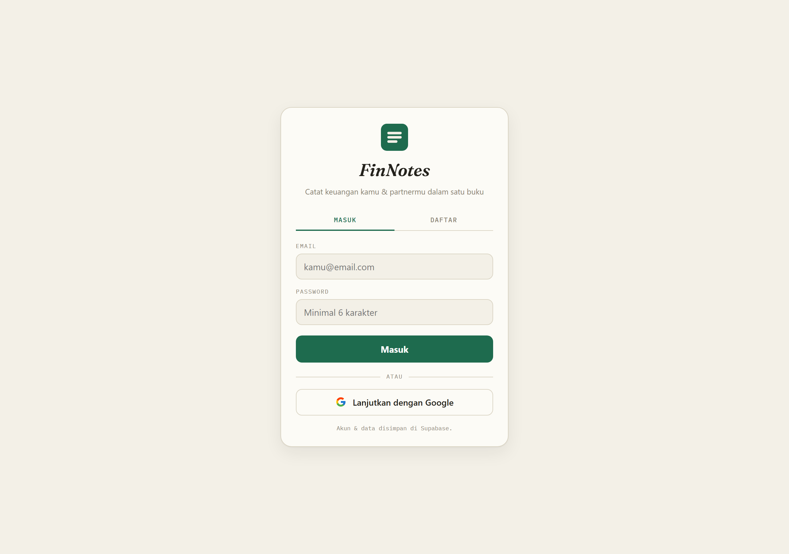
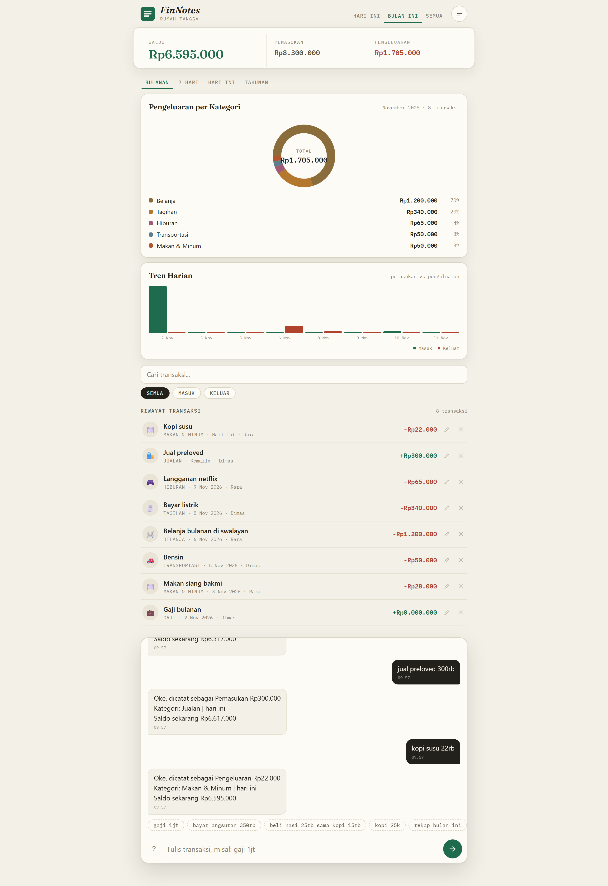

# FinNotes

Pencatatan keuangan lewat chat bahasa Indonesia. Ketik seperti ngobrol,
aplikasinya yang mem-parse, membuat transaksi, menghitung saldo, dan menyimpan
riwayat.

Multi-user: dua akun (misalnya kamu dan partnermu) melihat **buku keuangan yang sama**.

## Tampilan





## Demo

- **<https://finnotes.tenzou.dev>** — produksi: satu ekosistem Cloudflare
  (Worker + D1), di-deploy otomatis dari repo ini tiap ada push ke `main`
- <https://finnotes.tenzou-dev.workers.dev> — URL alternatif Worker yang sama

URL produksi punya social preview (OG image, `public/img/og.png`) saat dibagikan
ke chat/media sosial. Untuk preview repo di GitHub itu sendiri, upload gambar
yang sama lewat **Settings → Social preview**.

## Fitur

- Parser bahasa Indonesia tanpa API eksternal: `gaji 8jt`, `beli nasi 25rb sama kopi 15rb`
- Multi-transaksi per pesan, format `1,2jt` dan `1.000.000` aman
- Multi-user dengan satu household bersama, pendaftaran lewat **kode undangan**
- Masuk dengan **akun Google** (opsional) — cukup Client ID, tanpa client secret
- Grafik: donat kategori, batang harian, perbandingan periode
- Export CSV (transaksi dan rekap) plus backup JSON
- Edit dan hapus transaksi dari UI
- Data di **Cloudflare D1** (SQLite); produksi dan lokal memakai store & schema
  yang sama persis, tinggal beda binding

## Kebutuhan

- Node.js **>= 22.5** (memakai modul bawaan `node:sqlite`)
- Akun Cloudflare (untuk deploy: Worker + D1)

## Menjalankan cepat (lokal)

Tidak perlu konfigurasi apa pun. Otomatis memakai SQLite lokal
(`data/finnotes.db`); schema di-apply sendiri saat server mulai.

```bash
npm install
npm start
```

Buka <http://localhost:3000>, lalu daftar akun pertama.

Konfigurasi lewat `.env` (salin dari `.env.example`; Node >= 20.12 memuatnya
otomatis):

| Variabel | Default | Keterangan |
| --- | --- | --- |
| `SQLITE_FILE` | `data/finnotes.db` | file DB lokal; `:memory:` untuk test |
| `PBKDF2_ITERATIONS` | `10000` | iterasi hash password |
| `GOOGLE_CLIENT_ID` | - | mengaktifkan tombol Google (opsional) |
| `PORT` | `3000` | port HTTP |

## Testing

```bash
npm test             # parser + splitter (81 test)
npm run test:all     # + e2e server lokal (61 test)
npm run test:worker  # e2e Worker + store D1 (112 test)
npm run check:worker # pastikan bundle Worker bersih dari API Node
```

E2E lokal menjalankan `server.js` sendiri dengan DB `:memory:` — tidak perlu
server terpisah. Yang diuji: signup, dua user satu household, isolasi antar
household, chat multi-transaksi, analytics semua periode, export, edit, hapus,
login/logout, dan verifikasi ID token Google (RS256/ES256, termasuk rotasi
kunci JWKS).

## Deploy ke Cloudflare Workers + D1

1. **Buat database D1**: dashboard Cloudflare → **Storage & Databases → D1 →
   Create database**, beri nama `finnotes`, salin **Database ID**.
2. **Isi `deploy/wrangler.toml`**: ganti `database_id` dengan ID tadi. Tidak ada
   migrasi manual — schema di-apply sendiri oleh Worker saat request pertama
   (idempotent, aman diulang).
3. (Opsional) isi `GOOGLE_CLIENT_ID` di `[vars]` — lihat bagian Google Sign-In.
4. Deploy:

```bash
npm --prefix deploy ci
npm --prefix deploy run deploy
```

**Custom domain**: Worker Settings → Domains & Routes → Add → Custom Domain
(misalnya `finnotes.tenzou.dev`); DNS record dan sertifikat dibuat otomatis
Cloudflare.

**Auto-deploy dari GitHub**: hubungkan repo ke Workers Builds (dashboard Worker
→ Settings → Builds). Setiap push ke `main` men-deploy otomatis.

Instruksi lengkap: [`deploy/README.md`](deploy/README.md).

## Google Sign-In (opsional)

Tombol **Lanjutkan dengan Google** muncul sendiri di halaman login begitu
`GOOGLE_CLIENT_ID` terisi. Client ID OAuth bersifat publik (muncul di halaman
login), jadi tidak perlu disimpan sebagai secret.

### 1. Google Cloud Console

1. Buka <https://console.cloud.google.com/apis/credentials> (buat / pilih
   project).
2. **OAuth consent screen**: External, isi nama app + email support, lalu
   **Publish app** supaya bisa dipakai siapa pun (scope hanya
   `openid email profile`, tidak butuh verifikasi Google).
3. **Create Credentials → OAuth client ID → Web application**:
   - Authorized JavaScript origins: `https://<domain-produksi>` **dan**
     `http://localhost:3000` (untuk development)
   - Simpan **Client ID** (client secret tidak dipakai).

### 2. Pasang Client ID

- Produksi: isi `GOOGLE_CLIENT_ID` di `[vars]` pada `deploy/wrangler.toml`
- Lokal: isi di `.env` (server Express) atau `deploy/.dev.vars` (`wrangler dev`)

### 3. Alurnya

Tombol GIS (Google Identity Services) → Google menyerahkan credential (ID token
JWT) langsung ke browser → frontend `POST /api/auth/google` → **server**
memverifikasi tanda tangan lewat JWKS Google (RS256/ES256) beserta klaim
`iss`/`aud`/`exp`/`email_verified` → akun, household, dan sesi dibuat
server-side. Email Google yang sudah terdaftar otomatis tersambung ke akun
lama (password tetap jalan).

## Struktur

```
server.js               Express: auth, chat, state, analytics, export (lokal)
src/parser.js           parse satu transaksi dari teks
src/splitter.js         pecah satu pesan jadi banyak transaksi
src/assistant.js        command dan orkestrasi chat
src/analytics.js        agregasi kategori, harian, perbandingan
src/csv.js              export CSV
src/oidc.js             verifikasi ID token Google (JWKS, WebCrypto)
src/store/d1.js         store tunggal untuk Worker & server lokal
src/store/schema.js     schema DDL (self-apply, idempotent)
src/store/node-d1.js    adapter node:sqlite → antarmuka D1 (khusus Node)
src/store/index.js      entry store untuk server lokal
public/                 UI tanpa framework
deploy/                 Worker Cloudflare (worker.js, wrangler.toml, test)
test/                   parser, splitter, e2e
```

## Catatan keamanan

- Password di-hash **PBKDF2-SHA256** (default 10.000 iterasi ≈ 3,5 ms CPU
  Workers free plan). Jumlah iterasi ikut tersimpan di tiap hash, jadi default
  bisa dinaikkan kapan saja tanpa memutus user lama
- Sesi = bearer token acak, TTL 30 hari, tanpa refresh token; **logout
  menghapus baris sesi di server** sehingga token langsung mati
- Isolasi antar household ditegakkan di setiap query (cek membership) — tidak
  ada `service_role` atau layanan pihak ketiga
- ID token Google diverifikasi penuh di server sebelum dipercaya; klien tidak
  pernah menulis data sendiri
- Gunakan password yang kuat, minimal 6 karakter
